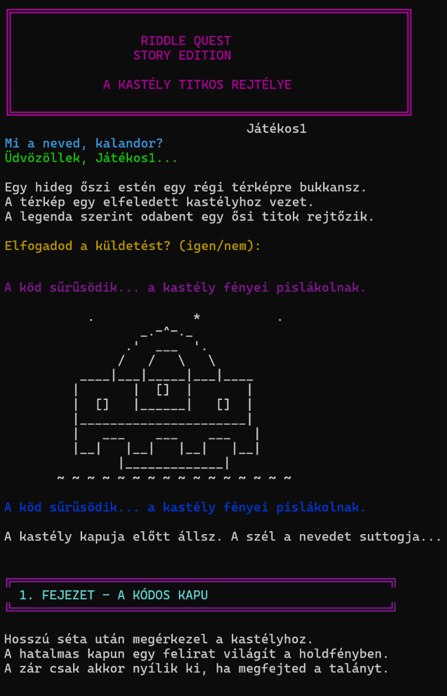

# 👻 The Castle — Story Edition

A spooky, interactive text adventure built with **PHP CLI**.

Explore a mysterious castle, solve riddles, and uncover its secrets. But be careful — the ghost won't let everyone leave alive.

## ✨ Features

- 🎭 ASCII art animations and ANSI terminal colors
- 📖 Story-driven gameplay with multiple chapters
- 🧩 Interactive riddles with hints
- 🔄 Three attempts per challenge
- 🏆 Multiple endings based on your answers
- ⌨️ Typewriter-style text effects
- 🇭🇺 Hungarian-language gameplay
- 📦 No external dependencies

## 🎮 Gameplay



Your adventure takes you through a mysterious castle, where you must solve three riddles to uncover an ancient secret.

Will you claim the treasure, or become another prisoner of the castle?

## 🚀 Getting Started

### Requirements

- PHP 8.0 or newer recommended
- A terminal with ANSI color support

### Run the game

Clone the repository:

```bash
git clone https://github.com/Martin20213/the-castle-minigame
cd the-castle
```

Start the game:

```bash
php index.php
```

## 🛠️ Built With

- PHP
- ANSI escape codes
- ASCII art
- PHP CLI input/output

## 📸 Gameplay

The game features animated castle scenes, a moving stone gate, a ghost encounter, and an animated treasure chest — all rendered directly in the terminal.

## 📄 License

This project is open source. See the `LICENSE` file for details.
